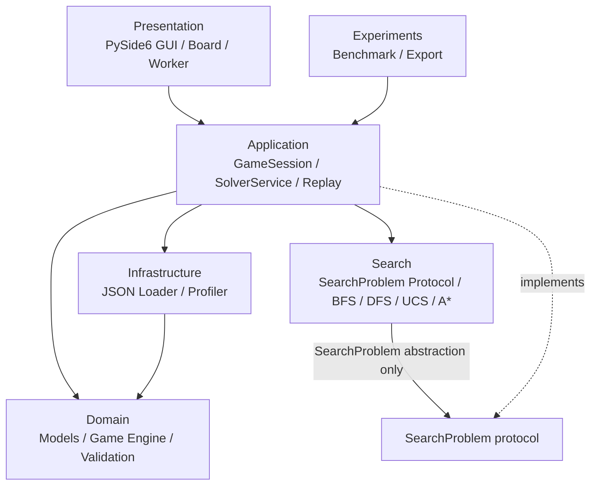

# Bloxorz Solver — Project Architecture & Implementation Specification

> **Tài liệu đầu vào cho Codex** | Môn: CSC14003 — Introduction to Artificial Intelligence | Project 1: Bloxorz Solver  
> **Mục đích:** Định nghĩa kiến trúc, phạm vi chức năng, hợp đồng giữa các module, cấu trúc mã nguồn và thứ tự triển khai.  
> **Nguồn yêu cầu:** `AI - Project 1.pdf` (8 trang). Các lựa chọn kỹ thuật được ghi **[Đề xuất]**; yêu cầu trực tiếp từ đề bài được ghi **[Bắt buộc]**.

---

## 1. Mục tiêu và phạm vi

Xây dựng **ứng dụng desktop 2D có thể chơi được** cho Bloxorz và tích hợp **BFS, DFS/IDS, UCS, A\*** để tự động giải level. Người dùng phải có thể:

1. Chơi game bằng bàn phím và/hoặc nút điều khiển.
2. Chọn level, tạo game mới, restart.
3. Chọn solver và **quan sát quá trình tìm kiếm trực tiếp trên GUI** (Search Visualization).
4. Xem **đường đi lời giải được phát lại** (Solution Replay).
5. Xem các chỉ số: thời gian tìm kiếm, peak memory, expanded nodes, số bước trong lời giải.
6. Chạy benchmark độc lập với GUI để phục vụ báo cáo khoa học.

### 1.1. Checklist chấm điểm theo đề

| Hạng mục | Điểm | Yêu cầu |
|---|---:|---|
| Core game mechanics | 10 | Floor, void, goal; khối 1×1×2; 3 hướng; 4 hướng lăn; kiểm tra rơi/thắng |
| Advanced mechanics | 10 | Fragile tiles, bridge, soft/heavy/split switch, split/rejoin, toggle/permanent bridge effects |
| BFS | 10 | Cài đặt thủ công |
| DFS hoặc IDS | 10 | Cài đặt thủ công, chống lặp |
| UCS | 10 | Cài đặt thủ công, thiết kế/giải thích cost function |
| A* | 10 | Cài đặt thủ công, thiết kế/giải thích heuristic |
| Report — algorithms | 10 | State, actions, transition, goal, cost, heuristic, visited policy |
| Report — experiments | 20 | Bộ test chung; time, peak memory, expanded nodes, solution length; bảng, biểu đồ, phân tích |
| Demo video | 10 | GUI + feature demo, tải YouTube và đưa public URL vào PDF báo cáo |
| **Tổng** | **100** | |

**[Bắt buộc]** Python; GUI web/desktop đều hợp lệ; phải **tự viết** các thuật toán tìm kiếm (không dùng thư viện giải thuật có sẵn). Có thể sử dụng thư viện hỗ trợ UI/cấu trúc dữ liệu. Đây là bài nhóm, thời lượng khoảng 3 tuần.

### 1.2. Ngoài phạm vi bản đầu tiên

- Không cần đồ họa 3D theo game gốc; giao diện 2D rõ ràng đáp ứng yêu cầu về chơi và demo.
- Không cần backend, tài khoản, database, web API hoặc triển khai cloud.
- Không cần level editor kéo-thả, multiplayer, online leaderboards.
- Không cần AI/LLM khác ngoài các thuật toán tìm kiếm của đề bài.

---

## 2. Stack công nghệ

| Thành phần | Công nghệ | Trạng thái / ghi chú |
|---|---|---|
| Ngôn ngữ | **Python >= 3.11** | [Bắt buộc: Python; đề xuất phiên bản >=3.11] |
| Desktop GUI | **PySide6 (Qt for Python)** | [Đề xuất] |
| Board rendering | **QGraphicsView/QGraphicsScene** hoặc custom QWidget + QPainter | [Đề xuất] Chọn một cách, ưu tiên dễ kiểm thử |
| Concurrency GUI | **QThread + Qt Signals** (hoặc QThreadPool/QRunnable) | [Đề xuất] Không block UI thread |
| Core game engine | **Python thuần** | [Đề xuất] Không phụ thuộc PySide6 |
| Search algorithms | **Python standard library**: `collections.deque`, `heapq`, `dataclasses`... | Tự cài BFS/DFS/UCS/A* |
| Data model | `dataclasses(frozen=True)`, `Enum`, `typing` | [Đề xuất] Immutable, hashable state |
| Level files | **JSON** (`json` trong stdlib) | [Đề xuất] Không hardcode level |
| Testing | **pytest** | [Đề xuất] |
| Static quality | **Ruff** (lint + format) | [Đề xuất] |
| Timing | **time.perf_counter()** | [Đề xuất] |
| Peak memory | **tracemalloc** | [Đề xuất] Đo peak Python allocations, không phải toàn bộ RAM OS |
| Experiment data | **CSV** (+ `pandas` nếu cần) | [Đề xuất] |
| Charts | **matplotlib** | [Đề xuất] |
| Packaging | **pyproject.toml** + **requirements.txt** | `pyproject.toml` là nguồn khai báo dependency chính; `requirements.txt` phục vụ cách chạy theo yêu cầu nộp bài |

**Nguyên tắc:** tối thiểu hóa dependency và chỉ thêm framework khi nó giải quyết một nhu cầu rõ ràng.

---

## 3. Kiến trúc tổng thể

**Kiến trúc:** Modular Layered Architecture (áp dụng các nguyên tắc Clean Architecture một cách vừa đủ, không lạm dụng abstraction).



> Sơ đồ thể hiện luồng sử dụng. Trong mã nguồn, `search/` định nghĩa `SearchProblem` protocol; `application/game_problem.py` implement protocol đó. **`search/` tuyệt đối không import từ `domain/`, `application/`, `presentation/`.**

### 3.1. Quy tắc phụ thuộc (dependency rules)

- `domain/`: **không import** module thuộc `application/`, `search/`, `infrastructure/`, `presentation/`.
- `search/`: chỉ import stdlib và các type nằm trong chính `search/`.
- `application/`: có thể import `domain/`, `search/` và abstraction phù hợp; không import PySide6.
- `infrastructure/`: được sử dụng model Domain để parse JSON/đo metrics; Domain không biết Infrastructure.
- `presentation/`: giao tiếp qua application services; không tự áp dụng luật game hay thuật toán tìm kiếm.
- `experiments/`: dùng cùng solver service/engine, **không sao chép** solver.

### 3.2. Nguyên tắc thiết kế bắt buộc trong code

1. **Một nguồn luật game duy nhất**: cả chơi tay, search và replay dùng chung `domain.engine.transition()`.
2. **Không mutate Search State**: input state và output state bất biến; không chứa GUI state, frame/timer hoặc counter trong `GameState`.
3. **Tách Static Level vs Dynamic GameState**: layout trong `Level`; trạng thái cầu và khối nằm trong `GameState`.
4. **Deterministic & pure transition**: cùng `(level, state, action)` luôn cho cùng kết quả; không dùng random, I/O, GUI trong engine.
5. **Solver-agnostic UI**: mọi thuật toán trả cùng `SearchResult` và phát cùng định dạng `SearchEvent`.
6. **GUI non-blocking**: solver chạy ở worker thread; widget chỉ được thay đổi trên UI thread.
7. **Experiment isolation**: đo solver không render, không sleep, không ghi event trực quan hóa.
8. **Thêm chức năng không phá API cũ**: ưu tiên module nhỏ, typed interfaces, unit test.
9. **Không overengineering**: không tạo generic Repository/Factory/DI container/Plugin Engine nếu chưa có use case.

---

## 4. Cấu trúc thư mục chuẩn

```text
bloxorz-solver/
├── main.py                          # Entry point GUI
├── pyproject.toml                   # Package/dependencies, pytest, ruff
├── requirements.txt                 # Cài đặt thuận tiện cho người chấm
├── README.md                        # Setup, run GUI, benchmark, tests
├── .gitignore
│
├── src/
│   └── bloxorz/
│       ├── __init__.py
│       │
│       ├── domain/                  # LUẬT GAME: Python thuần
│       │   ├── __init__.py
│       │   ├── models.py            # Position, enums, BlockState, Level, GameState
│       │   ├── engine.py            # transition(), legal_actions(), is_goal()
│       │   └── validation.py        # Validate cấu hình và invariant
│       │
│       ├── search/                  # TÌM KIẾM TỔNG QUÁT: không biết Bloxorz
│       │   ├── __init__.py
│       │   ├── protocols.py         # SearchProblem[S, A], SearchOptions
│       │   ├── result.py            # SearchResult, SearchStatus
│       │   ├── events.py            # SearchEvent, EventType, EventSink
│       │   ├── bfs.py
│       │   ├── dfs.py                # DFS hoặc IDS; lựa chọn ghi rõ trong report
│       │   ├── ucs.py
│       │   ├── astar.py
│       │   └── heuristics.py         # Helper heuristic tổng quát (nếu cần)
│       │
│       ├── application/             # ĐIỀU PHỐI USE CASE
│       │   ├── __init__.py
│       │   ├── game_session.py      # Load/restart/play/state snapshot
│       │   ├── game_problem.py      # Adapter Bloxorz -> SearchProblem
│       │   ├── solver_service.py    # Chạy solver và metrics
│       │   └── replay_controller.py # Timeline/step của solution replay
│       │
│       ├── infrastructure/          # LƯU TRỮ & ĐO ĐẠC
│       │   ├── __init__.py
│       │   ├── level_loader.py      # JSON <-> Level; validate schema
│       │   └── profiler.py          # Timing + tracemalloc
│       │
│       ├── presentation/            # PYSide6 GUI
│       │   ├── __init__.py
│       │   ├── main_window.py       # Layout, controls, metrics/status
│       │   ├── board_widget.py      # Draw board, block, overlay, animations
│       │   ├── solver_worker.py     # QThread, signals, cancellation
│       │   └── visualization_controller.py
│       │                             # Search-event buffering & playback speed
│       │
│       └── experiments/             # BENCHMARK KHÔNG GUI
│           ├── __init__.py
│           └── benchmark.py         # Batch levels x algorithms, CSV/plots
│
├── levels/
│   ├── basic/                       # Floor/void/goal
│   └── advanced/                    # Fragile, switches, bridges, split
│
├── tests/
│   ├── conftest.py
│   ├── test_models.py
│   ├── test_engine.py
│   ├── test_advanced_tiles.py
│   ├── test_search.py
│   ├── test_level_loader.py
│   └── test_integration.py
│
├── results/                          # Generated; ignore large artifacts in git
│   ├── metrics/
│   └── charts/
│
└── docs/
    ├── architecture.md             # Có thể copy hoặc link tài liệu này
    ├── gameplay_conventions.md     # Quy ước các tình huống chưa được đề rõ
    ├── test_plan.md
    └── report_notes.md              # Kết quả thực nghiệm / nguồn tài liệu
```

**Lưu ý:** khi tạo package, `__init__.py` phải tồn tại ở các thư mục Python tương ứng. Chỉ tách thêm module khi file đã lớn hoặc có trách nhiệm độc lập rõ ràng; không bắt buộc tạo file chỉ để “đẹp” cấu trúc.

---

## 5. Domain: biểu diễn game đúng và độc lập GUI

### 5.1. Static `Level`

Lưu các thành phần **không đổi** khi người chơi lăn khối:

- `id`, `name`, `width`, `height`.
- Terrain grid: `FLOOR`, `VOID`, `GOAL`, `FRAGILE`.
- Một `start_position`, một `goal_position`.
- Danh sách `BridgeDefinition`: `id`, danh sách tọa độ ô cầu, `initially_open`.
- Danh sách `SwitchDefinition`: `id`, `position`, `kind` (`SOFT`, `HEAVY`, `SPLIT`), bridge effects; riêng split có hai spawn positions.
- Metadata tùy chọn: difficulty, description.

`Level` nên là immutable object. Index cho bridge/switch theo vị trí có thể được cache khi load level để transition không phải quét toàn bản đồ.

### 5.2. Dynamic `GameState`

Định dạng logic khuyến nghị:

```text
GameState = (BlockState, bridge_mask)
BlockState = NormalBlock | SplitBlock
NormalBlock = (anchor_row, anchor_col, orientation)
SplitBlock  = (cube_a_position, cube_b_position, active_cube)
bridge_mask = int  # bit thứ i là trạng thái bridge thứ i
```

- `Position(row, col)` dùng tọa độ **0-based**; `row` tăng xuống, `col` tăng sang phải.
- `Orientation`: `STANDING`, `HORIZONTAL`, `VERTICAL`.
- `NormalBlock.anchor`: với nằm ngang là **ô trái**, nằm dọc là **ô trên**, đứng là ô duy nhất.
- `SplitBlock`: lưu vị trí 2 cube **có danh tính A/B ổn định** và active index (0 hoặc 1). Đổi cube không hoán đổi danh tính.
- `bridge_mask`: thứ tự bit theo `bridge_ids` được xác định ổn định khi load level, không dựa vào hash ngẫu nhiên.
- `GameState` phải `frozen=True`, hashable; không lưu movement count hoặc elapsed time vào search state.
- `get_occupied_cells(block_state)` trả một/tập các ô khối chiếm, dùng thống nhất trong engine và render.

### 5.3. `Action`

```text
UP / DOWN / LEFT / RIGHT / SWAP_ACTIVE_CUBE
```

- Khi `NormalBlock`: chỉ 4 hướng lăn.
- Khi `SplitBlock`: 4 hướng dịch chuyển cube đang được điều khiển, cùng với `SWAP_ACTIVE_CUBE`.
- `SWAP_ACTIVE_CUBE` không phải động tác lăn. Nên báo cáo riêng `action_count`, `roll_count` và `swap_count` để làm rõ "solution length".

### 5.4. Game Engine API

**Tập trung các rule tại `domain/engine.py`:**

```python
# Pseudo-signatures để Codex dùng làm contract, chưa phải code hoàn chỉnh.
def initial_state(level: Level) -> GameState: ...
def occupied_cells(block: BlockState) -> tuple[Position, ...]: ...
def legal_actions(level: Level, state: GameState) -> tuple[Action, ...]: ...
def transition(level: Level, state: GameState, action: Action) -> TransitionResult | None: ...
def is_goal(level: Level, state: GameState) -> bool: ...
```

`TransitionResult` là immutable value chứa `next_state` và `game_events` (`SWITCH_TRIGGERED`, `BRIDGE_OPENED/CLOSED`, `BLOCK_SPLIT/MERGED`, v.v.). `None` đại diện hành động không hợp lệ; không mutate state đầu vào.

**Quy trình thực thi một transition:**

1. Xác định chuyển động dựa trên `BlockState` + `Action`.
2. Tính các ô khối sẽ chiếm sau di chuyển; kiểm tra board bounds.
3. Tính tương tác với tile đặc biệt, switch và bridge theo **quy tắc nhất quán**.
4. Xử lý split/merge nếu đủ điều kiện; cập nhật mask cầu.
5. Kiểm tra mọi ô cuối cùng được chống đỡ hợp lệ và không vi phạm fragile rule.
6. Trả state mới và danh sách game events.

### 5.5. Luật chơi bắt buộc từ đề bài

- Khối 1×1×2: đứng chiếm 1 ô; nằm ngang/dọc chiếm 2 ô kề nhau.
- Khi đứng, lăn sang hướng nào thì đổ nằm trên 2 ô ở hướng đó.
- Khi nằm dọc hướng lăn, lăn tiếp sẽ đứng; khi lăn ngang trục nằm thì vẫn nằm, dịch 1 ô.
- Bất kỳ phần nào của khối ở ngoài board / void không có cầu đang mở -> nước đi không hợp lệ.
- Chỉ thắng nếu **khối nguyên vẹn đứng đúng trên goal**. Khối nằm trên goal hoặc một cube nhỏ trên goal không thắng.
- Fragile tile: chịu được khối **nằm** nhưng không chịu được khối **đứng**.
- Bridge đóng được coi như void; bridge mở là tile đỡ bình thường.
- Soft switch: bị kích hoạt khi bất kỳ phần khối nào chạm; cube đơn cũng kích hoạt được.
- Heavy switch: chỉ khi **khối nguyên vẹn đứng** trên switch.
- Split switch: chỉ khi khối nguyên vẹn đứng; dịch chuyển khối đến các tọa độ chỉ định và tách làm hai cube 1×1×1.
- Khi 2 cube trở lại 2 ô kề nhau, ghép thành khối 1×1×2. Một cube đơn không thể kích hoạt heavy switch hoặc hoàn thành level.
- Bridge effect: `TOGGLE` hoặc `PERMANENT_SET_OPEN/CLOSED`, áp dụng tới các bridge liên kết.

### 5.6. Quy ước trường hợp biên [Đề xuất, cần test và ghi vào docs]

Đề PDF không đặc tả mọi trường hợp của switch và bridge. Codex phải triển khai theo **một bộ quy ước được ghi rõ**, không tự tạo rule ngầm:

1. Switch kiểu nhấn được kích hoạt khi **bắt đầu được nhấn** (unpressed -> pressed) bởi hành động di chuyển, không liên tục mỗi frame; `SWAP_ACTIVE_CUBE` không kích hoạt lại.
2. Nếu một action kích hoạt nhiều switch, áp dụng theo thứ tự `switch.id` ổn định để bảo đảm deterministic.
3. Sau khi switch làm cầu đóng/mở, kiểm tra độ hợp lệ của vị trí cuối; nếu cầu bị đóng ngay dưới khối đang đỡ bởi cầu, xem transition là thất bại/illegal. Ghi rõ là quy ước của project.
4. Split switch tạo hai cube tại hai spawn positions cố định; phải kiểm tra spawn hợp lệ. Không hợp nhất hai cube ngay trong cùng thao tác split; xét merge sau một thao tác di chuyển tiếp theo.
5. Game engine không tạo một state "rơi" để search mở rộng. Hành động gây rơi bị từ chối (`transition -> None`); GUI có thể hiển thị animation thất bại riêng.

**Yêu cầu quan trọng:** Các quy ước phải không phụ thuộc vào GUI và áp dụng giống nhau khi chơi tay, replay và search. Nếu thử game gốc thấy hành vi khác, sửa **một nơi trong engine và tests**.

---

## 6. Level Format: JSON, không hardcode board

Ví dụ **minh họa cấu trúc dữ liệu** (không khẳng định đây là level có lời giải):

```json
{
  "id": "example_switch",
  "name": "Switch Demo",
  "grid": [
    "########",
    "#S..G..#",
    "#...#..#",
    "########"
  ],
  "bridges": [
    {
      "id": "bridge_1",
      "cells": [[2, 4]],
      "initially_open": false
    }
  ],
  "switches": [
    {
      "id": "switch_1",
      "type": "soft",
      "position": [2, 2],
      "bridge_effect": {
        "mode": "toggle",
        "targets": ["bridge_1"]
      }
    }
  ],
  "difficulty": "basic"
}
```

**Ký hiệu grid:** `#` = VOID, `.` = FLOOR, `S` = starting floor, `G` = goal, `F` = fragile. Bridge được định nghĩa riêng trên các ô `#` tương ứng, không dùng lại ký tự `.` cho ô cầu. Switch được định nghĩa ở vị trí nền hợp lệ, không cần thêm ký tự riêng. `split` switch cần thêm `spawn_positions: [[r1,c1],[r2,c2]]`. Với permanent bridge effect, dùng `mode: "set"` và `open: true|false`.

`level_loader.py` phải kiểm tra:

- Mọi hàng có cùng độ dài; ký tự thuộc tập cho phép; đúng một `S`, một `G`.
- Tọa độ hợp lệ; không trùng vị trí bridge nếu không được thiết kế cho phép; bridge chỉ nằm trên ô void theo format này.
- ID switch/bridge không trùng; target ID phải tồn tại.
- Switch đúng cấu hình theo type; split có đúng 2 spawn positions; spawn hợp lệ.
- Tránh phụ thuộc vào thứ tự dictionary không được kiểm soát; gán bridge bit index ổn định.
- **Không** yêu cầu level phải có lời giải để load thành công; solvability là nhiệm vụ solver/test.

---

## 7. Search: thuật toán không phụ thuộc Bloxorz

### 7.1. Protocol

Đặt tại `search/protocols.py`:

```python
from typing import Hashable, Iterable, Protocol, TypeVar

S = TypeVar("S", bound=Hashable)
A = TypeVar("A")


class SearchProblem(Protocol[S, A]):
    @property
    def initial_state(self) -> S: ...

    def is_goal(self, state: S) -> bool: ...

    def successors(self, state: S) -> Iterable[tuple[A, S, float]]: ...
```

`application/game_problem.py` cung cấp `BloxorzProblem(SearchProblem[GameState, Action])`:

- Sử dụng `domain.engine.legal_actions()` / `transition()`.
- Mỗi successor trả `(action, next_state, step_cost)`.
- Cho phép inject `CostPolicy` từ application để chạy unit-cost hoặc weighted-cost.
- **Không nhân bản logic luật chơi** trong adapter.

### 7.2. Solver APIs và kết quả thống nhất

Mỗi solver export hàm `solve(problem, *, options, event_sink=None, cancel_check=None, ...) -> SearchResult[S,A]` với signature thống nhất ở mức cần thiết. A* nhận thêm `heuristic` callback. `SearchOptions` có thể chứa `max_expanded` để tránh treo demo.

`SearchResult` nên chứa:

- `status`: `FOUND`, `NO_SOLUTION`, `CANCELLED`, `LIMIT_REACHED`.
- `actions`: list hành động từ đầu tới đích.
- `states`: dãy state tương ứng, **bao gồm initial state**, để replay/tua.
- `total_cost`: tổng chi phí.
- `expanded_nodes`: số state thực sự được lấy ra để mở rộng.
- `generated_nodes` (optional) và thống kê frontier (optional).

Không bắt GUI phải phân tích nội bộ của từng solver để vẽ đường đi.

### 7.3. Thuật toán

| Solver | Data structure | Điểm quan trọng |
|---|---|---|
| BFS | `collections.deque` | Visited theo state; unit-cost; đường đi ít actions nhất |
| DFS | Stack | Chống cycle; không bảo đảm ngắn nhất; đặt giới hạn nếu cần |
| UCS | `heapq`, `best_g` | Giá trị cost **không âm**, trong project dùng **dương**; xử lý entry cũ trong heap; relax khi tìm `g` tốt hơn |
| A* | `heapq`, `best_g`, `g+h` | Heuristic hợp lệ, stale entries, reopen khi cải thiện `g`, reconstruct path |

Nếu nhóm chọn IDS thay DFS thì đặt `ids.py` thay `dfs.py`, ghi rõ trong báo cáo; không cần cài cả hai.

### 7.4. Cost policy

Có ít nhất hai chế độ:

1. **UnitCost**: tất cả action có cost = 1. Dùng để so sánh BFS với UCS/A* theo số action.
2. **WeightedCost**: rule có cost dương, định nghĩa rõ cho roll, fragile, switches, swap. Dùng minh họa khi UCS khác BFS; tránh cost mơ hồ hoặc cộng chồng ngoài ý muốn.

Luôn mô tả **đang tối ưu điều gì**. Khi cost không đồng nhất, `solution_cost` khác `solution_length`. Nếu A* tối ưu weighted cost, heuristic phải là lower bound của **weighted** remaining cost chứ không phải chỉ số bước nếu chi phí mỗi bước có thể <1.

### 7.5. Heuristic cho A*

- Bắt đầu với `zero_heuristic(state) = 0` (đúng nhưng không cung cấp thông tin).
- Với level **không teleport/split**, heuristic đơn giản có thể là `ceil(min_Manhattan_distance_from_occupied_cells_to_goal / 2)` khi mỗi action có cost >= 1; chứng minh lower bound trước khi sử dụng.
- Không tự ý cộng orientation penalty nếu chưa chứng minh tính admissible/consistent.
- Với split switch có **teleport**, heuristic khoảng cách hình học có thể **overestimate**. Dùng `h=0` an toàn cho các level đó cho đến khi có heuristic được chứng minh.
- Trong báo cáo: giải thích heuristic, admissible/consistent và mối liên hệ với cost policy.

---

## 8. Trực quan hóa thuật toán theo thời gian thực

**[Yêu cầu sản phẩm bổ sung từ nhóm]** Khi bấm BFS/DFS/UCS/A*, GUI phải hiển thị **quá trình đang search**, không chỉ một đường đi cuối.

### 8.1. Phân biệt 3 mode

1. **Manual Mode:** Điều khiển game bằng bàn phím, cập nhật `GameSession`.
2. **Search Visualization Mode:** Render snapshot của từng state đang được thuật toán mở rộng, có thể tô overlay và hiển thị counters. **Hai expanded states liên tiếp không nhất thiết là hai bước di chuyển liền nhau**.
3. **Solution Replay Mode:** Phát lại đúng chuỗi action/states của lời giải theo thứ tự hợp lệ.

Không được dùng thuật ngữ “animation đường đi” để mô tả danh sách node đã mở rộng.

### 8.2. Search event contract

`search/events.py`:

```python
# Pseudo-contract
class SearchEventType(Enum):
    NODE_DISCOVERED = "node_discovered"
    NODE_EXPANDED = "node_expanded"
    GOAL_FOUND = "goal_found"
    SEARCH_FINISHED = "search_finished"


@dataclass(frozen=True)
class SearchEvent(Generic[S]):
    event_type: SearchEventType
    state: S | None
    expanded_nodes: int
    frontier_size: int
    # thêm field hữu ích khi thật sự dùng, giữ cấu trúc nhẹ
```

- Solver có thể phát `SearchEvent` qua `event_sink: Callable[[SearchEvent], None] | None`.
- Với mode benchmark, `event_sink=None` để **không trả chi phí event/render**.
- `NODE_EXPANDED` giúp vẽ trạng thái đang xét; `GOAL_FOUND` và `SEARCH_FINISHED` giúp kết thúc UI đúng cách.
- Không yêu cầu gửi một event cho từng neighbor nếu không cần; event tracking phải optional.
- Nếu cần log/trace đầy đủ để step-by-step, tách nó khỏi fast mode và đặt giới hạn bộ nhớ.

### 8.3. Threading và hiệu suất UI

```text
Button click
  -> SolverWorker (QThread)
  -> SolverService.solve(snapshot of initial GameState)
  -> SearchAlgorithm emits events
  -> bounded event buffer / throttle
  -> Qt Signal -> VisualizationController (GUI thread)
  -> BoardWidget.render(state / overlays)
  -> finished -> SearchResult + Metrics -> ReplayController
```

- Chỉ **main Qt thread** được cập nhật widget.
- Buffer **có giới hạn**; nếu solver quá nhanh, gộp/bỏ bớt các frame hiển thị, **không** được làm sai kết quả search.
- GUI nên dùng timer để lấy một số event khỏi queue và render theo nhịp; worker không tự gọi các hàm paint/update của widget.
- Khi solver hoàn thành quá nhanh để quan sát bằng mắt, có thể giữ một **trace có giới hạn hoặc được lấy mẫu** và tiếp tục phát lại các search frames đã thu được, ghi rõ "Search finished — viewing recorded trace". Việc tua trace không đồng nghĩa thuật toán còn đang chạy.
- Thanh speed điều khiển **tốc độ hiển thị**, không buộc thuật toán sleep theo frame ở fast mode.
- Cần UI cập nhật counters khi đang chạy và hiển thị metrics cuối cùng.
- Vô hiệu hóa thao tác làm thay đổi session trong khi đang search **hoặc** áp dụng request ID + state snapshot để loại bỏ kết quả cũ.
- Hỗ trợ `Cancel` thông qua cờ hủy thread-safe; solver kiểm tra cờ theo chu kỳ. Không cưỡng bức terminate worker giữa lúc sửa trạng thái.

**Mức ưu tiên:** Search live + replay là tính năng chính; pause/resume, stepping và tracing 100% expanded nodes là cải tiến sau khi game engine ổn định.

### 8.4. Solution replay

- `ReplayController` quản lý index, speed, play/pause/reset và lựa chọn state trên timeline.
- Replay dùng `SearchResult.states/actions`, không đoán đường đi từ expanded nodes.
- Mặc định replay trên **preview state riêng**, không tự động mutate game đang chơi.
- Có thể bổ sung nút “Apply solution” để commit state kết thúc vào GameSession.

---

## 9. Vai trò chi tiết của từng module

| File/module | Trách nhiệm | Không được làm |
|---|---|---|
| `domain/models.py` | Định nghĩa immutable types, enums, static/dynamic state | I/O, GUI, search |
| `domain/engine.py` | 4 roll directions, split/swap/merge, switches, bridges, win/invalid moves | Render, đo metrics, file I/O |
| `domain/validation.py` | Invariant, kiểm tra cấu trúc model/level | Quyết định UI |
| `search/protocols.py` | Hợp đồng bài toán tìm kiếm | Import Bloxorz |
| `search/result.py` | Search status, solution path, counters | Chứa widget |
| `search/events.py` | Event schema + sink typing | Qt signal trực tiếp |
| `search/bfs.py` | BFS queue, parent, visited | Luật game riêng |
| `search/dfs.py` | DFS stack, visited, guard | Luật game riêng |
| `search/ucs.py` | UCS priority queue, best cost | Luật game riêng |
| `search/astar.py` | A* g/h/f, best cost, parent | UI, terrain rules |
| `search/heuristics.py` | Heuristic helper độc lập hoặc không dùng nếu Bloxorz-specific | Heuristic không chứng minh được |
| `application/game_session.py` | State phiên chơi; load/restart/apply_action | Vẽ widget |
| `application/game_problem.py` | Adapter state successors + cost cho solver | Thuật toán tìm kiếm |
| `application/solver_service.py` | Orchestrate solver, options, metrics, result | Tự tính next state |
| `application/replay_controller.py` | Timeline lời giải, progress | Search algorithm |
| `infrastructure/level_loader.py` | Read/parse/validate level JSON | Điều khiển UI |
| `infrastructure/profiler.py` | Timing/memory instrumentation | Vẽ chart |
| `presentation/main_window.py` | Board layout, buttons, status, search metrics | Luật di chuyển |
| `presentation/board_widget.py` | Vẽ level, khối, tile, highlights, replay frames | Mutate GameState |
| `presentation/solver_worker.py` | Worker thread, signals, cancellation | Sửa widget ngoài UI thread |
| `presentation/visualization_controller.py` | SearchEvent -> frames; speed, buffer, overlay | BFS/DFS logic |
| `experiments/benchmark.py` | Test cases x algorithms, run metrics, CSV/charts | GUI/render |

**Quy tắc mở rộng:** Nếu thêm `tile`, `switch` hoặc game mechanic mới, ưu tiên cập nhật `domain/models.py`, `domain/engine.py`, `domain/validation.py`, JSON schema và tests. Không sửa từng thuật toán. Nếu thêm thuật toán mới, chỉ cần tuân theo `SearchProblem`/`SearchResult`/`SearchEvent` contract và đăng ký nó với `SolverService` + GUI.

---

## 10. Các luồng chính

### 10.1. Manual gameplay

```text
Keyboard / control button
  -> MainWindow
  -> GameSession.apply_action(action)
  -> domain.engine.transition(level, current_state, action)
  -> GameSession stores next_state (nếu hợp lệ)
  -> BoardWidget renders new state and game_events
```

### 10.2. Solve & visualize

```text
Run Solver button
  -> validate selected level, algorithm and cost policy
  -> snapshot GameState
  -> SolverWorker -> SolverService
  -> BloxorzProblem -> SearchAlgorithm -> GameEngine
  -> SearchEvent -> Qt signal -> VisualizationController
  -> SearchResult + Metrics -> GUI
  -> ReplayController (người dùng chọn xem solution)
```

### 10.3. Headless benchmarks

```text
Benchmark CLI
  -> same level loader
  -> same SolverService, algorithm implementations
  -> event_sink=None, no GUI, no sleep
  -> profiler(time, peak memory)
  -> CSV -> plots -> report
```

---

## 11. GUI: màn hình và controls

**Main Window (2D)** tối thiểu có:

- Level selector, New Game, Restart.
- Bàn cờ dễ phân biệt floor/void/goal/fragile/bridge/switch; render đủ 3 orientation và split cubes.
- Keyboard arrows + Space (đổi active cube trong split mode); thêm on-screen controls nếu thuận tiện.
- Solver selection: BFS, DFS hoặc IDS, UCS, A*; Run, Cancel.
- Chọn **Search Process** vs **Solution Replay**; speed slider (slow ↔ fast).
- Search panel: current expanded node (preview), expanded count, frontier size, search status.
- Result panel: found/not found, search time, peak memory, expanded nodes, `action_count`, `roll_count`, total cost.
- Replay Play/Pause/Restart/Seek (seek là nice-to-have nếu có thời gian).

**Trạng thái UI:** idle / manual / searching / solved / replaying / cancelled / error. Xử lý trạng thái rõ ràng để không thể bấm các hành động xung đột.

---

## 12. Metrics và thực nghiệm

### 12.1. Bắt buộc theo đề

| Metric | Cách đo / ý nghĩa |
|---|---|
| Search Time | `time.perf_counter()` đo **chỉ solver** |
| Memory Usage | `tracemalloc` peak allocated memory của Python trong phạm vi đo được xác định |
| Expanded Nodes | Đếm số trạng thái thực sự expand theo định nghĩa nhất quán |
| Solution Length | Số bước di chuyển; ghi rõ cách xử lý `SWAP_ACTIVE_CUBE` |

Có thể bổ sung `total_cost`, `generated_nodes`, peak frontier, success rate và `roll_count` để tăng chất lượng phân tích.

### 12.2. Phương pháp benchmark

1. Sử dụng **tập level cố định** cho mọi thuật toán; chia basic / fragile / switch / combined / split.
2. Cùng môi trường, cấu hình, state ban đầu và cost policy khi so sánh.
3. Không tính thời gian parse JSON, render GUI, phát event hoặc replay vào search time.
4. Chạy lặp (ví dụ >= 3 lần) theo mức thời gian cho phép và báo cáo median time.
5. Ghi metadata: Python version, OS, CPU nếu có, phương pháp đo memory, limit dừng.
6. Nếu solver không tìm thấy lời giải hoặc chạm limit, ghi rõ trạng thái thay vì đặt length=0.
7. Xuất CSV và biểu đồ so sánh time, memory, expanded nodes, solution length; bình luận trade-off.
8. **Unit-cost:** BFS/UCS/A* (heuristic admissible) nên có optimal action count giống nhau; DFS có thể khác.
9. **Weighted-cost:** So sánh `total_cost`, không diễn giải “ít bước hơn” là “chi phí tối ưu hơn”.

**Quan trọng:** `tracemalloc` đo Python allocations, không đại diện trực tiếp cho RSS toàn tiến trình (đặc biệt là Qt/C extensions). Định nghĩa memory phải nhất quán và được ghi rõ trong report.

---

## 13. Testing & quality gates

### 13.1. Unit tests phải có

- [ ] Test toàn bộ **3 orientation × 4 directions**: chính xác tọa độ/định hướng mới.
- [ ] Illegal move: vượt board/void; đứng trên fragile; cầu đóng.
- [ ] Win chỉ khi khối nguyên vẹn đứng ở goal.
- [ ] Soft/Heavy/Split switch đúng điều kiện kích hoạt.
- [ ] Bridge toggle, permanent-open/permanent-closed; nhiều bridge; khác mask => khác state.
- [ ] Split teleport; swap active cube; solo cube trên soft switch; rejoin ngang/dọc.
- [ ] `GameState` immutable + hashable, transition deterministic.
- [ ] JSON loader parse đúng, báo lỗi rõ cho level invalid.
- [ ] BFS path được validate lại bằng engine và tối ưu action count ở unit cost.
- [ ] DFS/IDS không mắc vòng lặp; xử lý unsolvable.
- [ ] UCS tối ưu total cost với weighted cost trên các bài nhỏ biết đáp án.
- [ ] A* (`h=0` và heuristic admissible) đồng optimal cost với UCS ở các bài nhỏ.
- [ ] Replay state/action sequence hợp lệ; worker cancel không làm crash/treo GUI.
- [ ] Không có import dependency ngược từ domain/search sang GUI.

### 13.2. Lệnh chất lượng đề xuất

```bash
python -m pytest -q
ruff check .
ruff format --check .
```

**Quality gate:** Không chuyển sang bước tiếp theo nếu core engine test chưa pass hoặc thuật toán tạo đường đi không được engine chấp nhận.

---

## 14. Hướng dẫn cài đặt và chạy dự kiến

Đề xuất dùng `pyproject.toml` làm nơi định nghĩa package + runtime dependencies, với nhóm dev extras (`pytest`, `ruff`). Duy trì `requirements.txt` tương thích để giảng viên dễ chạy. Trên máy Linux:

```bash
python3 -m venv .venv
source .venv/bin/activate
pip install -r requirements.txt
python main.py
```

Có thể cung cấp thêm:

```bash
pip install -e '.[dev]'
pytest -q
python -m bloxorz.experiments.benchmark --help
```

Codex phải tạo `README.md` thực tế khớp với các entry points triển khai, ghi rõ Python version và cách chạy PySide6 trên hệ điều hành được hỗ trợ. Không được để tài liệu ghi lệnh chưa chạy được.

---

## 15. Kế hoạch triển khai theo milestone

### M1 — Skeleton + Core Model / Engine

- Tạo cấu trúc source package và cấu hình môi trường.
- Hoàn thiện models, validation, JSON loader, initial state.
- Implement 12 orientation transitions và basic win/invalid moves.
- Tests pass với level cơ bản.

**Done:** có thể tạo state và chạy chuỗi action mà không cần GUI.

### M2 — Search Baseline + Shared Contracts

- Tạo SearchProblem, SearchResult, SearchEvent.
- BloxorzProblem adapter.
- BFS + DFS/IDS + UCS + A*; parent/path reconstruction; visited/best_g.
- Kiểm chứng lời giải trên level nhỏ, `h=0`, unit cost.

**Done:** headless CLI/tests giải được basic levels; mọi solver dùng cùng engine.

### M3 — Advanced Game Mechanics

- Fragile, bridge, soft/heavy/split switch, toggle/set, split/rejoin.
- Mở rộng JSON format và test edge cases.
- Kiểm chứng cả 4 solver trên advanced levels.

**Done:** logic mọi advanced tile đúng, stable, deterministic.

### M4 — GUI + Live Search + Replay

- PySide6 main window + 2D board + controls.
- GameSession + SolverWorker + event buffering + live visualization.
- ReplayController + metrics panel + speed control + cancellation.

**Done:** chơi thủ công và xem trực tiếp thuật toán giải; sau đó phát lại lời giải.

### M5 — Benchmark + Report Readiness

- Fixed test set, repeated measurement, result CSV/plots.
- Readme, tài liệu sử dụng, screenshot/demo.
- Tối ưu lỗi UX, kiểm thử tích hợp, chuẩn bị demo video + report.

**Done:** có số liệu tái lập được và hệ thống đủ để quay video demo.

### Phân công gợi ý nhóm 4 người

- **Member A:** domain models/engine và gameplay conventions.
- **Member B:** search, heuristics/cost policy, correctness tests.
- **Member C:** PySide6 presentation, visualization/replay.
- **Member D:** level loader, integration/benchmark, report & QA.

Cần code review chéo tại các điểm giao; thay đổi API công khai phải được cả nhóm thống nhất. Lưu tỷ lệ hoàn thành công việc theo thành viên để báo cáo đúng yêu cầu đề.

---

## 16. Bàn giao và tiêu chí nghiệm thu

### 16.1. Deliverables

- Source Python runnable, `README.md`, `requirements.txt`.
- JSON levels basic + advanced minh họa mọi cơ chế.
- Tối thiểu BFS, DFS hoặc IDS, UCS, A* tự cài.
- GUI chơi được, chọn solver, Search Visualization, Solution Replay.
- Test suites; benchmark CSV và charts.
- Báo cáo PDF: phân chia công việc; mô tả thuật toán; bảng/biểu đồ/thảo luận; tài liệu tham khảo; appendix về AI use nếu có.
- Demo YouTube có URL public trong báo cáo; phụ đề hoặc thuyết minh Việt/Anh.
- Nén `.zip` hoặc `.rar` theo tên `StudentID1_StudentID2_...`; nếu >20 MB, upload Drive và nộp link theo hướng dẫn đề.

### 16.2. Acceptance Criteria

- [ ] Chạy game từ `README.md` trên môi trường Python đã chỉ định.
- [ ] Người dùng hoàn thành level bằng điều khiển thủ công.
- [ ] Basic và advanced mechanics hoạt động chính xác.
- [ ] Bốn solvers hoạt động với **cùng level/state/engine**.
- [ ] Người dùng thấy states đang mở rộng và counters trong lúc solver chạy.
- [ ] Replay hiển thị đường đi **hợp lệ**, không nhầm expanded states với solution.
- [ ] Các solver trả đúng success/failure và không làm GUI freeze.
- [ ] Benchmark không tính thời gian render/animation.
- [ ] Tests qua và kết quả báo cáo truy vết được về version/config của chương trình.

---

## 17. Hướng dẫn Codex thực thi tài liệu

**Vai trò:** Bạn là software engineer triển khai một ứng dụng môn AI từ đặc tả này. Hãy ưu tiên **correctness, modularity, readability, testability** và sự phù hợp với bài nhóm 3 tuần.

### Quy tắc thực hiện

1. Đọc hết file này và kiểm tra hiện trạng repository trước khi sửa code.
2. Viết kế hoạch triển khai theo M1–M5, chỉ tạo abstraction vừa đủ.
3. **Bắt đầu M1 trước**, tập trung vào `domain` và test; không làm GUI khi engine chưa ổn định.
4. Duy trì ranh giới import tại §3 và public contracts tại §5–§8.
5. **Không** dùng thư viện search solver có sẵn; tự cài BFS/DFS/UCS/A*.
6. Nếu phát hiện phần gameplay không được PDF chỉ rõ, ghi một quyết định vào `docs/gameplay_conventions.md`, không âm thầm phỏng đoán và thay đổi nhiều nơi.
7. Mọi thay đổi về mechanic phải có test, mọi sửa lỗi solver phải có regression test.
8. Sau mỗi milestone, chạy tests/lint, báo cáo files thay đổi, những gì đã hoạt động, vấn đề còn lại và next step.
9. Giữ `README.md` và dependency files chạy được; không tạo placeholders giả thành tính năng hoàn chỉnh.
10. Không thay yêu cầu gốc bằng thiết kế khác nếu không có lý do được ghi rõ; không thêm backend/web app/AI model khi chưa được yêu cầu.

### Thứ tự ưu tiên khi thiếu thời gian

1. **Tính đúng đắn của luật chơi và 4 solver**.
2. **Advanced mechanics** bắt buộc.
3. GUI chơi được + solution replay + live visualization ở mức cơ bản.
4. Metrics, benchmark và report.
5. Hiệu ứng nâng cao, step-by-step, level editor và tinh chỉnh UI.

**Nguyên tắc cuối:** Game engine là nguồn sự thật duy nhất; Search chỉ thao tác trên abstract state graph; Application điều phối; GUI chỉ hiển thị và tương tác. Thiết kế đơn giản trước, mở rộng khi có nhu cầu thật.
