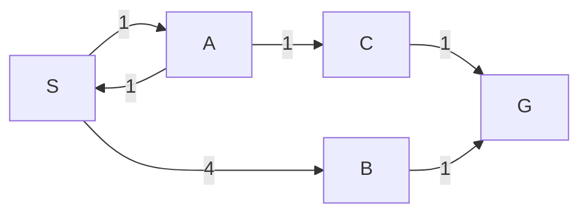

# Interface chung cho BFS, DFS, UCS và A*

Mục tiêu: mỗi bạn viết một thuật toán trong module riêng; khi tích hợp chỉ đăng ký hàm `solve`. Đây là hướng dẫn triển khai, các module search bên dưới **chưa có trong code hiện tại**. Quy ước này theo phần 7 của [kiến trúc](../../PROJECT_ARCHITECTURE.md), dùng API engine thực tế.

**Dành cho người chưa đọc code:** đọc phần 1–4 để hiểu đồ thị và thử thuật toán bằng ví dụ nhỏ. Phần 5–10 là hợp đồng triển khai/tích hợp. Người viết BFS/DFS/UCS/A* chỉ dùng `SearchProblem`; người phụ trách tích hợp chuẩn bị adapter và các type chung trước khi chạy solver trên game.

## 1. Game được chuyển thành đồ thị như thế nào?

Đây là **đồ thị trạng thái có hướng**, được sinh dần khi tìm kiếm. Không cần tạo sẵn toàn bộ đồ thị hoặc ma trận kề.

| Khái niệm | Ý nghĩa trong bài này |
| --- | --- |
| Đỉnh / state | Toàn bộ tình trạng game tại một thời điểm |
| Cạnh | Một action hợp lệ đưa state hiện tại sang state kế tiếp |
| Đỉnh bắt đầu | `problem.initial_state` |
| Đỉnh đích | Bất kỳ state nào có `problem.is_goal(state) == True` |
| Trọng số cạnh | `step_cost` do `problem.successors(state)` trả về |
| Đường đi | Chuỗi action từ state đầu tới một state đích |

**Một ô trên bàn không phải một đỉnh của đồ thị.** Khối ở cùng vị trí nhưng hướng khác, cầu mở/đóng khác hoặc cube đang chọn khác sẽ có các nước đi tiếp theo khác nhau. Switch và teleport cũng có thể khiến cạnh không đảo ngược được; không tự thêm cạnh ngược.

Ví dụ thực tế ở stage 01, `bridge_mask=0` trong cả chuỗi:

| State | Khối `(row, col, orientation)` | Action để đến đây | Là đích? |
| --- | --- | --- | --- |
| s0 | `(2, 1, STANDING)` | Bắt đầu | Không |
| s1 | `(2, 2, HORIZONTAL)` | RIGHT từ s0 | Không |
| s2 | `(2, 4, STANDING)` | RIGHT từ s1 | Không |
| s3 | `(2, 5, HORIZONTAL)` | RIGHT từ s2 | Không |
| s4 | `(2, 7, STANDING)` | RIGHT từ s3 | Có |

Đường thắng là `(RIGHT, RIGHT, RIGHT, RIGHT)`, gồm 4 cạnh và 5 state. Không có công thức cố định kiểu `col += 1` cho mọi action: engine đã tính việc lăn, nằm/đứng và các cơ chế đặc biệt.

## 2. State chứa gì, so sánh và kiểm tra ra sao?

Bạn có thể xem state là một **giá trị bất biến**, đưa thẳng vào set/dict. Thông tin sau chỉ giúp hiểu dữ liệu; BFS/DFS/UCS không cần tự đọc từng field:

| Dữ liệu hiện có | Ý nghĩa |
| --- | --- |
| `GameState.block` | Khối nguyên vẹn hoặc hai cube đã tách |
| `NormalBlock(row, col, orientation)` | Tọa độ neo trên/trái và hướng `STANDING`, `HORIZONTAL`, `VERTICAL` |
| `SplitBlock(cube_a, cube_b, active_cube)` | Hai tọa độ `[row, col]`; `active_cube` là 0 hoặc 1 |
| `GameState.bridge_mask` | Bitmask lưu trạng thái mở/đóng của mọi cầu; giữ nguyên giá trị khi dùng làm key |

`state_a == state_b` đã so sánh toàn bộ dữ liệu này; `hash(state)` cũng đã được hỗ trợ. Tọa độ bắt đầu từ 0. Bản đồ, switch và đích nằm trong level cố định mà adapter giữ, không cần chép vào mỗi state.

- **Đã gặp state chưa?** BFS/DFS dùng `state in visited`; không dùng riêng `(row, col)` và không tự sắp xếp lại hai cube.
- **State có phải đích?** Gọi `problem.is_goal(state)`. Engine yêu cầu khối nguyên vẹn đứng trên ô đích; nằm qua đích hoặc cube đơn trên đích chưa thắng.
- **State kế tiếp có hợp lệ?** Mọi successor do adapter trả ra đã hợp lệ. Không cần tự kiểm tra vực, fragile, switch hay cầu. State hiện tại cũng phải đến từ adapter hoặc một snapshot hợp lệ do application cung cấp.
- **Đã gặp nhưng đường mới rẻ hơn?** UCS/A* so sánh `new_g` với `best_g.get(next_state, inf)`, không bỏ state chỉ vì nó từng xuất hiện.

## 3. Ba thao tác duy nhất solver cần biết

```python
state = problem.initial_state                 # Thuộc tính, không có dấu ()
won = problem.is_goal(state)                   # bool
neighbors = tuple(problem.successors(state))  # Có thể rỗng nếu hết đường

for action, next_state, step_cost in neighbors:
    # Đưa next_state vào queue/stack/heap theo thuật toán của bạn.
    # Lưu parent[next_state] = (state, action) khi chấp nhận đường đi này.
    pass
```

`action` là nhãn cạnh để trả lại và replay, không cần tự diễn giải. Khi chạy game, nhãn là `Action.UP/DOWN/LEFT/RIGHT/SWAP_ACTIVE_CUBE`; khi khối tách, swap cũng là một cạnh và mặc định có cost 1.

Thuật toán tự quản lý frontier, visited/best_g và parent. Khi gặp goal, lần ngược `parent` về state đầu rồi đảo thứ tự để lấy actions và states. Với UCS/A*, phải cập nhật parent khi tìm được cost tốt hơn. Goal không có successor vẫn có thể là lời giải; frontier cạn mà chưa gặp goal mới là hết lời giải.

## 4. Đồ thị mẫu để làm thuật toán mà chưa cần chạy game

Đồ thị dưới đây có cycle và trọng số khác nhau, dùng kiểm tra BFS/DFS/UCS/A*. Chữ S, A, B, C, G là tên các đỉnh; số trên cạnh là cost.



Copy class sau vào file test của bạn. Nó dùng đúng ba API ở trên và chạy được độc lập, không import game hay Qt; không cần kế thừa `SearchProblem` để có cùng interface.

```python
class TinyGraph:
    """Đồ thị nhỏ dùng làm dữ liệu đầu vào cho solver."""

    initial_state = "S"

    def __init__(self):
        self.edges = {
            "S": (("to_a", "A", 1.0), ("to_b", "B", 4.0)),
            "A": (("to_s", "S", 1.0), ("to_c", "C", 1.0)),
            "B": (("to_g", "G", 1.0),),
            "C": (("to_g", "G", 1.0),),
            "G": (),
        }

    def is_goal(self, state):
        """Kiểm tra đỉnh đích."""
        return state == "G"

    def successors(self, state):
        """Trả các cạnh đi ra theo thứ tự cố định."""
        return self.edges[state]


problem = TinyGraph()
assert problem.initial_state == "S"
assert not problem.is_goal("S")
assert problem.is_goal("G")
assert problem.successors("G") == ()
assert problem.successors("S")[0] == ("to_a", "A", 1.0)
```

Sau khi có các type chung và hàm `solve`, truyền `TinyGraph()` vào chính hàm solver đó; khi tích hợp chỉ thay bằng `BloxorzProblem(level)`.

| Thuật toán | Kết quả kỳ vọng trên đồ thị mẫu |
| --- | --- |
| BFS | `S → B → G`, actions `("to_b", "to_g")`, 2 bước, cost 5 |
| DFS | Một đường hợp lệ, không lặp vô hạn tại `S ↔ A`; kết quả phụ thuộc thứ tự duyệt |
| UCS | `S → A → C → G`, actions `("to_a", "to_c", "to_g")`, 3 bước, cost 3 |
| A* với `h=0` | Cùng cost tối ưu 3 như UCS |

Để thử unit cost, đổi cost cạnh `S → B` từ 4 thành 1: BFS/UCS/A* (`h=0`) đều tối ưu ở 2 bước. Để thử vô nghiệm, bỏ các cạnh vào G; để thử state đầu là goal, đặt `problem.initial_state = "G"`. Bài test này giúp kiểm tra thuật toán mà không phụ thuộc luật Bloxorz.

## 5. Chốt phần dùng chung trước khi chia việc

Một người triển khai và kiểm thử các file chung trước; các thành viên còn lại chỉ viết thuật toán và tests riêng:

```text
src/bloxorz/
  search/
    __init__.py
    protocols.py          # SearchProblem, SearchOptions
    result.py             # SearchStatus, SearchResult
    events.py             # SearchEvent, SearchEventType
    bfs.py                # Bạn A: solve(...)
    dfs.py                # Bạn B: solve(...)
    ucs.py                # Bạn C: solve(...)
    astar.py              # Bạn D: solve(..., heuristic=...)
  application/
    game_problem.py       # BloxorzProblem: nối engine với SearchProblem
    solver_service.py     # Đăng ký thuật toán, gọi hàm, đo time/memory
```

`search/` chỉ import stdlib và module trong `search/`; không import Bloxorz, Qt hay `GameSession`. Như vậy mọi thuật toán chỉ cần hiểu cùng một đồ thị trạng thái.

## 6. Interface bài toán

Đặt trong `search/protocols.py`:

```python
from collections.abc import Hashable, Iterable
from typing import Protocol, TypeVar

S = TypeVar("S", bound=Hashable)
A = TypeVar("A", covariant=True)

class SearchProblem(Protocol[S, A]):
    @property
    def initial_state(self) -> S: ...

    def is_goal(self, state: S) -> bool: ...

    def successors(self, state: S) -> Iterable[tuple[A, S, float]]: ...
```

Mỗi successor là `(action, next_state, step_cost)`. State phải bất biến và hash được để dùng làm key trong `visited`, `parent`, `best_g`.

`BloxorzProblem(level, start=None, cost_policy=None)` trong application thực hiện:

- `initial_state`: dùng `start` nếu được truyền, nếu không gọi `engine.initial_state(level)`.
- `is_goal(state)`: gọi `engine.is_goal(level, state)`.
- `successors(state)`: duyệt `UP, DOWN, LEFT, RIGHT`; thêm `SWAP_ACTIVE_CUBE` khi khối đang tách. Gọi `engine.transition()` đúng một lần cho mỗi action và chỉ yield kết quả có outcome `MOVED` hoặc `WON`.
- Mặc định mọi action, kể cả swap, có cost `1.0`. Cost khác dùng callback `cost_policy(state, action, next_state) -> float`, luôn hữu hạn và dương.

**Lưu ý API hiện tại:** `transition()` trả `TransitionResult`, không trả `None` khi rơi. Phải bỏ kết quả `LOST` và `INVALID`. Engine xử lý toàn bộ fragile, switch, bridge, split/rejoin; adapter không tự viết lại luật.

## 7. Hàm và kết quả thống nhất

Mỗi module thuật toán export cùng chữ ký sau; các type được import từ những file chung ở phần 5:

```python
def solve(
    problem: SearchProblem[S, A],
    *,
    options: SearchOptions | None = None,
    event_sink: Callable[[SearchEvent[S]], None] | None = None,
    cancel_check: Callable[[], bool] | None = None,
) -> SearchResult[S, A]: ...
```

`Callable` lấy từ `collections.abc`; trong module thuật toán dùng `A = TypeVar("A")` thông thường. `SearchOptions` là dataclass bất biến có `max_expanded: int | None = None`; `None` nghĩa là không giới hạn. Mỗi solver dùng cấu hình mặc định khi `options=None`.

`SearchStatus` là enum gồm `FOUND`, `NO_SOLUTION`, `CANCELLED`, `LIMIT_REACHED`. `SearchResult[S, A]` là dataclass bất biến:

| Field | Kiểu / quy ước |
| --- | --- |
| `status` | `SearchStatus` |
| `actions` | `tuple[A, ...]`: hành động từ đầu đến đích |
| `states` | `tuple[S, ...]`: gồm cả state đầu và đích |
| `total_cost` | `float \| None`: tổng step cost; `None` nếu chưa tìm được lời giải |
| `expanded_nodes` | `int`: số lần thực sự mở rộng node, không tính goal và entry cũ bị bỏ qua |

Khi `FOUND`: `len(states) == len(actions) + 1`. Nếu state đầu đã là goal, trả actions rỗng, một state, cost `0.0`, expanded `0`. Các status còn lại trả actions/states rỗng. Frontier cạn mới là `NO_SOLUTION`; chạm giới hạn là `LIMIT_REACHED`. Kiểm tra goal trước khi áp dụng giới hạn cho lần mở rộng tiếp theo.

Để trực quan hóa sau này, thống nhất `SearchEvent[S]` có `event_type`, `state: S | None`, `expanded_nodes`, `frontier_size`; enum event gồm `NODE_DISCOVERED`, `NODE_EXPANDED`, `GOAL_FOUND`, `SEARCH_FINISHED`. Khi có sink, gọi `event_sink(event)` tại thời điểm tương ứng và gửi `SEARCH_FINISHED` cho mọi status kết thúc; khi sink là `None`, bỏ qua tạo/phát event. Kiểm tra `cancel_check()` trước mỗi lần mở rộng; trả `CANCELLED` khi callback báo `True`.

## 8. Quy ước để thuật toán chạy độc lập

- Dùng **toàn bộ state** làm key. Với Bloxorz, `GameState` đã hash được và chứa orientation, hai cube, cube đang chọn và `bridge_mask`; không chỉ dùng tọa độ hay tự đổi thứ tự hai cube.
- BFS dùng queue, DFS dùng stack và đều chống lặp. UCS/A* dùng `best_g`, cập nhật parent khi có cost tốt hơn, bỏ heap entry cũ; thêm bộ đếm thứ tự để heap không phải so sánh các state khi trùng priority.
- BFS tối ưu số action; DFS không bảo đảm tối ưu. UCS/A* tối ưu tổng cost. BFS và UCS chỉ tương đương về tối ưu khi mọi step cost bằng nhau.
- A* nhận thêm keyword `heuristic: Callable[[S], float]`; dùng `h=0` làm baseline. Heuristic cho Bloxorz được tạo ở application và truyền vào. Split có teleport nên khoảng cách Manhattan thông thường chưa bảo đảm admissible.
- Giữ thứ tự successor cố định để tests tái lập được. Không sửa input, gọi GUI, `sleep`, đọc file hay đo metrics riêng trong thuật toán.
- `solver_service.py` đo `elapsed_seconds` bằng `perf_counter()` và `peak_memory_bytes` bằng `tracemalloc` quanh lời gọi solver, trả kèm `SearchResult`. Benchmark chạy tuần tự, `event_sink=None`, không tính load level/render/replay; ghi rõ đây là bộ nhớ Python allocations.

## 9. Đăng ký và gọi chung

Ví dụ sau áp dụng khi các module đã được triển khai:

```python
from functools import partial
from bloxorz.search import astar, bfs, dfs, ucs
from bloxorz.application.game_problem import BloxorzProblem

def zero_heuristic(state):
    """Baseline hợp lệ cho mọi stage, kể cả teleport."""
    return 0.0

SOLVERS = {
    "bfs": bfs.solve,
    "dfs": dfs.solve,
    "ucs": ucs.solve,
    "astar": partial(astar.solve, heuristic=zero_heuristic),
}

problem = BloxorzProblem(level)  # level đã được load; mặc định unit cost
result = SOLVERS["bfs"](problem, options=None)
```

Thêm thuật toán mới: tạo module có `solve(...)`, thêm một entry vào `SOLVERS`. GUI lấy danh sách tên từ registry và gọi qua service; solver chạy ở worker, còn replay gọi `window.play(action)` trên UI thread, chờ animation xong mới phát action tiếp theo.

## 10. Tests chung trước khi tích hợp

1. Đồ thị nhỏ: có lời giải, không có lời giải, có cycle và state đầu đã là goal; kiểm tra cancel và giới hạn node.
2. Phát lại `result.actions` từ đúng state đầu bằng engine; mọi bước hợp lệ, khớp `result.states`, state cuối là goal và tổng cost đúng. Kiểm tra cả 10 stage, kể cả swap và split/rejoin.
3. Với unit cost, BFS/UCS/A* (`h=0`) có cùng số action tối ưu; DFS chỉ cần trả lời giải hợp lệ. Với weighted cost, so sánh cost của UCS/A* thay vì độ dài đường đi.
4. Mỗi solver gọi hai lần vẫn chạy độc lập; không giữ frontier/visited toàn cục và không thay đổi state/session đang chơi.
